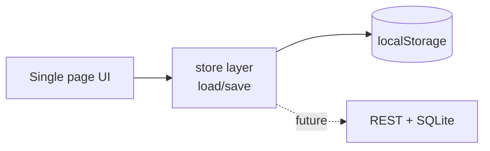

# Service Request & Operations Tracker

**Personal Project** — by Jeff Mutisya. Not client work.

A small ops ticketing app: request lifecycle, priorities, notes,
filter/search and a dashboard. Runs anywhere — vanilla JS +
localStorage, no build step, no backend.

## 1. Project overview

Requests tracked across chat and spreadsheets lose state. This app is
one list with a lifecycle, built to demonstrate requirements analysis,
UI design, data modelling and testing on a realistic ops problem.

## 2. Problem statement

A small support/ops team needs to know: what is open, who owns it,
what was agreed, and what is overdue — without buying or hosting a
ticketing system.

## 3. Objectives

- CRUD service requests with status lifecycle + priorities
- Notes thread per request; filter/search; dashboard summary
- Zero-install demo (double-click `app/index.html`)
- Documented data model + SQLite migration path

## 4. Architecture



## 5. Technology stack

Vanilla HTML/CSS/JS, no dependencies. `docs/architecture.md` maps the
store to a future SQLite schema.

## 6. Repository structure

```text
app/index.html app/styles.css app/app.js   # the demo
docs/architecture.md                        # requirements, schema, tests
```

## 7. Setup instructions

No build. Open `app/index.html` in any modern browser, or serve it:

```bash
cd app && python -m http.server 8000   # then http://localhost:8000
```

## 8. How it works

State lives in `localStorage` (`srt-requests-v1`). The form prepends a
request; status `<select>` and note inputs mutate it; filters re-render
the list; the dashboard recounts on every render. Seed data is fictional
demo content, clearly marked in code.

## 9. Screenshots

Run the demo and capture: dashboard counts, filtered list, notes
thread. Capture points are listed in `docs/architecture.md` test
checklist. (No borrowed screenshots shipped.)

## 10. Testing

Manual checklist in `docs/architecture.md` (7 checks: create, status,
notes, search, filters, reset, persistence). Automatable later with
Playwright against the same page.

## 11. Security considerations

- Demo has no auth: any browser user can edit local data — by design
  for a local demo, must change before any shared deployment.
- `esc()` output-encoding on all rendered fields (XSS hygiene).
- No network calls, no trackers, no stored PII beyond what you type.

## 12. Limitations

- Single-browser storage; no multi-user, no server backup.
- No auth/roles (see the SaaS prototype repo for the roles concept).
- Seed IDs are naive (`REQ-1000+n`) — fine for demo, not for production.

## 13. Future improvements

- REST + SQLite backend per `docs/architecture.md`
- Due dates + oldest-open alerts; CSV export; Playwright tests

## 14. Lessons learned

- Drawing the module boundary at `load()/save()` kept the backend
  migration a two-function change — boundaries first, code second.
- A manual test checklist written *before* coding caught two filter
  bugs that "just clicking around" would have missed.
